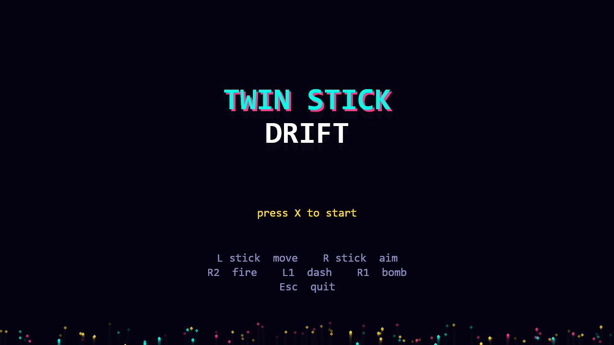
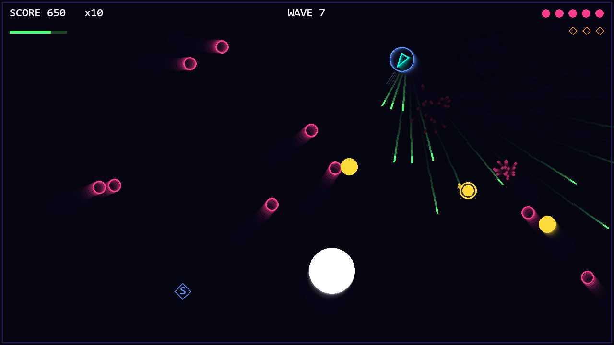

# Twin Stick Drift

A neon top-down arena shooter built with Python and pygame, designed for a PS4 controller (keyboard and mouse also work).




## Run

```
pip install -r requirements.txt
python main.py
```

Requires Python 3.9+. Connect your controller before or after launching.

## Controls

| Action | PS4 controller | Keyboard / mouse |
|---|---|---|
| Move | Left stick | WASD |
| Aim | Right stick | Mouse |
| Fire | R2 (or push right stick hard) | Left click |
| Dash (brief invincibility) | L1 | Space |
| Bomb | R1 | E |
| Start / restart | X or Options | Enter / R |
| Back to title (game over) | Circle | T |
| Quit | | Esc |

## Gameplay

- Survive increasingly hard waves of chasers and shooters. A boss arrives every 5th wave.
- Chain kills to build a score multiplier (up to x10).
- Enemies sometimes drop power-ups:
  - **3**: triple shot for 10 seconds
  - **S**: shield that absorbs one hit
  - **B**: bomb (stores up to 3) that damages everything on screen
  - **+**: restores 1 HP
- The controller rumbles when you shoot, dash, score kills and take damage.

All sounds and music are generated in code, so there are no asset files.

## License

[MIT](LICENSE)

## Notes

Button numbers in [main.py](main.py) match the PS4 pad under pygame 2 on Windows. Other controllers or platforms may number them differently; adjust the constants at the top of the file.
